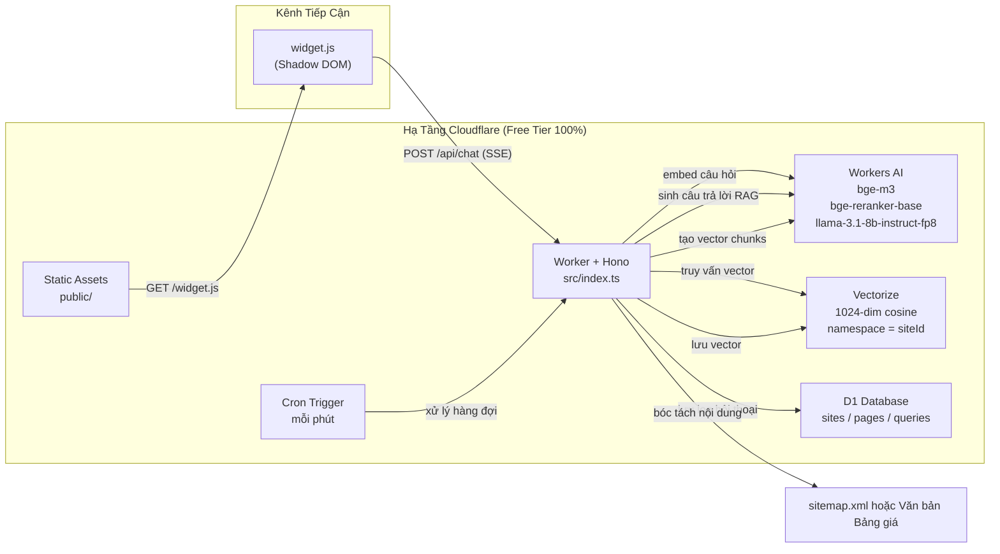

<div align="center">

# Social Agentic AI Livechat

**Trợ lý AI Livechat Tự Hành & RAG Thông Minh chạy 100% trên Cloudflare Free Tier (Chi phí $0).**

[English](README.md) | [Tiếng Việt](README.vi.md)

Nhúng trực tiếp vào website bằng 1 thẻ `<script>` hoặc kết nối đa kênh qua MCP. Tự động trả lời khách hàng theo thời gian thực (Streaming SSE) dựa trên dữ liệu tri thức của riêng bạn. Không cần API key trả phí. Không máy chủ riêng. Không phát sinh hóa đơn.

[](https://deploy.workers.cloudflare.com/?url=https://github.com/liamakeup/social-agentic-livechat)
[](LICENSE)
[](https://hono.dev)
[](https://workers.cloudflare.com)

</div>

---

## 📸 Giao Diện Trực Quan

| Khung Livechat nhúng trên Website                                                   | Bảng Điều Khiển Admin (`/admin`)                                                              |
|-------------------------------------------------------------------------------------|-----------------------------------------------------------------------------------------------|
|    |         |

Khung chat streaming trả lời nhanh kèm trích dẫn nguồn (bên trái); Trang quản trị độc lập để quản lý tri thức, bảng giá, cấu hình và theo dõi câu hỏi của người dùng (bên phải).

---

## 💡 Tại Sao Nên Dùng Social Agentic Livechat?

Các dịch vụ chatbot AI thương mại (Chatbase, CustomGPT, Mendable...) thường tính phí từ **$20 – $400/tháng**. Về bản chất, chúng chỉ là sự kết hợp giữa: bộ cào dữ liệu (crawler), mô hình embedding, vector database và LLM. 

Cloudflare hiện cung cấp tất cả các thành phần này với **gói miễn phí (Free Tier)** cực kỳ hào phóng:

| Thành phần | Dịch vụ Cloudflare sử dụng | Hạn mức gói miễn phí (Free Tier) |
|---|---|---|
| **API & Bộ điều phối** | **Cloudflare Workers** + Hono | 100.000 requests/ngày |
| **Embedding + Rerank + LLM** | **Workers AI** (`bge-m3`, `bge-reranker-base`, `llama-3.1-8b-instruct-fp8`) | 10.000 neurons/ngày (~hàng trăm lượt trả lời/ngày) |
| **Tìm kiếm ngữ nghĩa (Vector Search)** | **Cloudflare Vectorize** (1024 chiều, cosine) | 5 triệu dimensions lưu trữ, 30 triệu dimensions truy vấn/tháng |
| **Cơ sở dữ liệu & Log hội thoại** | **Cloudflare D1** (Serverless SQLite) | 5 GB lưu trữ, 5 triệu lượt đọc/ngày |
| **Tác vụ ngầm định kỳ** | **Cron Triggers** | Tích hợp sẵn (chạy mỗi phút) |
| **Lưu trữ Widget & Admin UI** | **Static Assets** | Tích hợp sẵn |

Dự án này liên kết tất cả các thành phần trên vào **một Worker duy nhất**, triển khai chỉ bằng một câu lệnh!

---

## ✨ Tính Năng Nổi Bật

- **Nhúng siêu tốc bằng 1 thẻ `<script>`:** `<script src="https://<worker-domain>/widget.js" data-site-id="my-site"></script>`. Viết bằng Vanilla JS & Shadow DOM (<10 KB), độc lập hoàn toàn, không xung đột CSS trang web chủ.
- **Phản hồi Streaming thời gian thực:** Trả lời dạng Server-Sent Events (SSE) kèm chip nguồn trích dẫn, tự động nhận diện và phản hồi đúng ngôn ngữ người hỏi (Tiếng Việt, Tiếng Anh...).
- **Tìm kiếm đa ngôn ngữ vượt trội:** Sử dụng mô hình `@cf/baai/bge-m3` hỗ trợ hơn 100 ngôn ngữ, tối ưu đặc biệt cho tiếng Việt có dấu.
- **Truy xuất 2 giai đoạn (Two-stage Retrieval):** Lấy 20 đoạn vector gần nhất, sau đó dùng Cross-Encoder `@cf/baai/bge-reranker-base` chấm điểm lại để chọn lọc những đoạn thông tin chính xác nhất đưa vào LLM.
- **Cơ chế Fallback thông minh:** Tự động chuyển mạch sang các nhà cung cấp OpenAI-Compatible (Groq, DeepSeek, OpenRouter) khi Workers AI chạm trần hạn mức hoặc gặp sự cố.
- **Đa người dùng / Đa website (Multi-tenant):** Một lần deploy duy nhất có thể phục vụ nhiều website/chi nhánh khác nhau, mỗi website là một namespace Vectorize độc lập.
- **Cào sitemap tự động:** Hỗ trợ sitemap index, sitemap nén `.gz`, tự động loại bỏ rác (header, footer, nav, script) bằng engine Rust native `HTMLRewriter`.
- **An toàn cho gói Free Tier:** Chia nhỏ việc cào và tạo vector thành từng mẻ nhỏ qua Cronjob, tự động bỏ qua LLM khi không tìm thấy thông tin phù hợp để tiết kiệm tối đa quota.
- **Bảng điều khiển Admin tích hợp (`/admin`):** Nhập sitemap, thêm bảng giá/FAQ trực tiếp, theo dõi tiến trình cào dữ liệu, lấy mã nhúng và xem toàn bộ lịch sử câu hỏi của khách hàng.
- **Giao diện hiện đại:** Hỗ trợ Dark / Light mode, tùy biến màu sắc thương hiệu, vị trí góc trái/phải màn hình.

---

## 🛠️ Kiến Trúc Hoạt Động



* **Quy trình nạp dữ liệu (Indexing):** Tiếp nhận danh sách trang hoặc bảng giá $\rightarrow$ Đưa vào hàng đợi D1 $\rightarrow$ Cronjob đánh thức Worker bóc tách nội dung bằng `HTMLRewriter` $\rightarrow$ Chia đoạn ~350 tokens $\rightarrow$ Tạo vector 1024 chiều bằng `bge-m3` $\rightarrow$ Lưu vào Vectorize.
* **Quy trình Chat Livechat:** Khách đặt câu hỏi $\rightarrow$ Tạo vector câu hỏi $\rightarrow$ Lấy 20 vector gần nhất trong namespace $\rightarrow$ Dùng `bge-reranker-base` xếp hạng lại $\rightarrow$ Lấy TOP-K đoạn xuất sắc nhất $\rightarrow$ Đưa vào Llama 3.1 $\rightarrow$ Stream câu trả lời về cho khách theo thời gian thực.

---

## 🚀 Hướng Dẫn Cài Đặt & Triển Khai

### 1. Chuẩn Bị
* Một tài khoản [Cloudflare](https://dash.cloudflare.com/sign-up) miễn phí đã kích hoạt Workers.
* Đã cài đặt [Bun](https://bun.sh) (phiên bản 1.1 trở lên).
* Đăng nhập Cloudflare CLI:
  ```bash
  bunx wrangler login
  ```

### 2. Khởi Tạo Tài Nguyên Trên Cloudflare
Chạy các lệnh sau trong terminal để tạo Vectorize Index và D1 Database miễn phí:

```bash
# 1. Tạo Vectorize Index 1024-dim với chuẩn cosine
bunx wrangler vectorize create social-livechat-index-m3 --dimensions=1024 --metric=cosine

# 2. Tạo D1 Database
bunx wrangler d1 create social-livechat-db
```

Sau khi chạy lệnh tạo D1, Cloudflare sẽ in ra `database_id`. Hãy sao chép mã này và dán vào file `wrangler.toml`:
```toml
[[d1_databases]]
binding = "DB"
database_name = "social-livechat-db"
database_id = "DÁN_DATABASE_ID_CỦA_BẠN_VÀO_ĐÂY"
```

### 3. Cài Đặt Mật Khẩu Quản Trị (ADMIN_TOKEN)
Tạo token bảo mật để đăng nhập vào trang `/admin`:
```bash
bunx wrangler secret put ADMIN_TOKEN
# Nhập mật khẩu ngẫu nhiên dài trên 16 ký tự (Ví dụ: openssl rand -hex 32)
```

### 4. Áp Dụng Migration Cho D1 Database
```bash
# Áp dụng migration lên database Cloudflare
bun run db:migrate
```

### 5. Build Widget & Deploy
```bash
# Cài đặt thư viện
bun install

# Build widget và deploy lên Cloudflare
bun run deploy
```

Worker của bạn sẽ sẵn sàng hoạt động tại địa chỉ: `https://social-agentic-livechat.<your-subdomain>.workers.dev`.

---

## 💻 Hướng Dẫn Sử Dụng

### 1. Truy cập Trang Quản Trị
Mở trình duyệt và vào:
```text
https://<domain-worker-cua-ban>/admin
```
Nhập `ADMIN_TOKEN` đã cấu hình ở bước 3 để bắt đầu quản trị.

### 2. Nạp Dữ Liệu Website / Bảng Giá
* Nhập **siteId** (ví dụ: `makeuplia`).
* Nhập **sitemapUrl** (ví dụ: `https://makeuplia.com/sitemap.xml`).
* Nhấn **Register & Queue**: Hệ thống sẽ tự động quét sitemap và tiến hành index ngầm qua Cronjob.

### 3. Nhúng Vào Website Của Bạn
Chèn đoạn mã sau vào trước thẻ đóng `</body>` của website:
```html
<script 
  src="https://<domain-worker-cua-ban>/widget.js" 
  data-site-id="makeuplia"
  data-accent="#f6821f"
  data-position="right">
</script>
```

---

## ⚙️ Các Biến Môi Trường Tùy Biến (`wrangler.toml`)

| Biến | Mặc định | Ý nghĩa |
|---|---|---|
| `MAX_PAGES` | `200` | Số trang tối đa được cào từ sitemap trong mỗi lần nạp. |
| `INDEX_BATCH_SIZE` | `3` | Số trang được xử lý trong mỗi phút của Cronjob (giữ thấp để không bị vượt CPU 10ms). |
| `TOP_K` | `4` | Số đoạn trích dẫn đưa vào ngữ cảnh LLM để trả lời. |
| `RERANK` | `true` | Bật/tắt chấm điểm chéo bằng `bge-reranker-base`. |
| `DAILY_CHAT_LIMIT` | `250` | Giới hạn số câu hỏi mỗi ngày cho mỗi site để tránh cạn kiệt quota. |
| `ALLOWED_ORIGINS` | `""` | Danh sách tên miền được phép nhúng widget (để trống sẽ chỉ cho phép chính tên miền đó). |

---

## 📄 Bản Quyền & Giấy Phép
Dự án được phân phối dưới giấy phép [MIT License](LICENSE).
Tự do sử dụng, chỉnh sửa và triển khai cho các dự án cá nhân hoặc thương mại.
